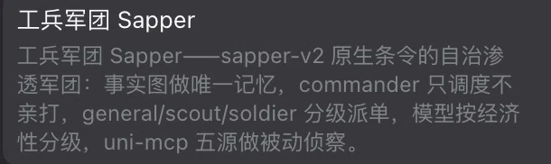

# 工兵军团 Sapper（sapper）— sapper-v2 原生条令的自治渗透军团

> 版本 1.1.0 ｜ preset id `sapper` ｜ bundle `dsh-preset-sapper`
> 上游：[N1nEmAn/sapper-v2](https://github.com/N1nEmAn/sapper-v2) @ `7b75e6f`（MIT）

把 [sapper-v2](https://github.com/N1nEmAn/sapper-v2) 的**条令**搬进 DSH，并按 DSH 的能力重写了它的**手**：

- sapper-v2 用 tmux 开 `claude` pane 当手 → 本模式用 `subagent` + 团队任务板；
- sapper-v2 用 Python CLI 读写事实图 → 本模式把事实图做成 **DSH 原生工具**（无外部 CLI、无 Python 依赖）；
- sapper-v2 靠离线 `kb/` 当知识库 → 本模式同一份 56 条条目，走 `sapper_kb` 工具；
- 侦察面接上了 **uni-mcp 五源**（白泽/重明/谛听/萤光）+ IP 地理 + cve-mcp；
- 事实图接进了 **DSH 原生宿主层**：工具只在 sapper 会话可见、每步自动读板、worker 按会话身份署名。

「工兵」是 sapper 的本义：**先破障，再让主力通过**。军团作战如此，渗透也是。

---

## 一、它和「猎场 Huntfield（campaign）」的区别

| 维度 | 猎场 Campaign | 工兵军团 Sapper |
|---|---|---|
| 记忆 | 文件仓（notes/STATE/raw/cases）+ 四层能力层 | **事实图 DAG**（fact/intent/hint，结构即状态） |
| 主线程 | 可以自己下场干 | **只调度，不亲打**（commander 边界） |
| 派单 | 任务板 + 自由发挥 | 决策表驱动的**时间盒升级**（scout→soldier→general→停放） |
| 记账 | notes.md 追加 | `sapper_write` 结构化入图（kind + data） |
| 知识库 | 本机 CLI + 注册表 | 内置 56 条 `sapper_kb` + cve-mcp 阶梯 |
| 恢复 | 读 STATE | 读 STATE + `sapper_state status`（以图为真） |
| 结论强度 | 证据三问 | 证据三问 + **HARD/SOFT/FALSE_MERGE 归因分级** |

两者不冲突：猎场适合"多战役、多目标、长期铺开"；军团适合"一个终态、要可交接、要能被人复核"的硬仗。

## 二、装了什么东西

### Host 插件：事实图（3 个原生工具）

| 工具 | 动作 |
|---|---|
| `sapper_state` | status / frontier / graph / show / doc / recall / validate（只读） |
| `sapper_write` | init / fact / intent / done / complete / hint / claim / release / confirm / flag / doc |
| `sapper_kb` | 56 条离线技术条目检索与整条阅读 |

- 图落在**当前会话工作目录**的 `.sapper/`（跟着 cwd 走，换目录 = 换图）。
- 磁盘格式与上游 sapper-v2 完全一致：`project.json` + `facts/` + `intents/` + `hints/`，一节点一 JSON，计数器自增、id 冲突跳过。**必要时上游 CLI 能打开同一张图。**
- 写入在进程内串行化，落盘用「临时文件 + rename」保证原子性（上游用 `fcntl.flock` 跨进程加锁；本插件不跨进程互斥，DSH 内通常单进程写）。
- **只在 sapper 会话可见**：三个工具按 `session.header.agentPreset` 门控，其它模式不再背这三份 schema；认不出 preset 时放行（宁可多给，不让 sapper 失能）。
- **每步自动读板**：`systemPrompt.context` 把 `[sapper 板]` 注入系统提示（终态／计数／frontier 前 3／待提交 flag／认领超时／上下文%），无图不注入、渲染失败不抛。
- **worker 自动署名**：`sapper_write` 不传 `worker` 时，根代理记 commander、子代理记其路径名（取不到用会话 id 短码）；`claim`/`done` 不再因为漏传名字互相打架。

### Preset：`sapper`（模式菜单里的「工兵军团 Sapper」）

- 工具面：standard 全套 + 常驻终端 + 跨会话检索 + 计划模式 + 压缩 + 子代理/工作流 + 定时任务。
- 内置 7 个技能（`bundledSkillDir`，rank 600，可被项目层 `<root>/.dsh/skills` 覆盖）：

| 技能 | 管什么 |
|---|---|
| `sapper-graph` | 事实图操作手册、三层文档、并发写盘、反注入 |
| `sapper-doctrine` | 战地条令：角色边界、读板循环、升级决策表、经济、NEVER |
| `sapper-legion` | DSH 编排：派单模板、任务板、模型分级、回传卡、写盘分片 |
| `sapper-sensors` | uni-mcp 五源 + IP 地理 + cve-mcp 的选择顺序与拼图套路 |
| `sapper-strike` | 本机弹药清单、指纹→CVE→nuclei 阶梯、证据门槛 |
| `sapper-triage` | 研判卡、形态判据、备案核验、归因三级 |
| `sapper-handoff` | STATE 模板、压缩协议、接班步骤、案例卡、收口自检 |

### 数据资产

- `kb/entries/*.json`：56 条上游知识库条目（离线、零依赖）。
- `templates/*.md`：上游的 reason/explore/verify 等 prompt 模板，供写 mission 时参考（DSH 不跑 `sapper dispatch`；模板里的 `sapper ...` 是上游 CLI 语法，落到本模式要映射成 `sapper_write` / `sapper_state`）。

## 三、怎么用

1. 模式菜单选 **工兵军团 Sapper**，开一个新会话（已有会话不换 preset）。
2. 会话工作目录**落在战役目录**（`cd` 到那儿再开，或开会话时选它）。
3. 第一句话给它终态，例如：
   > 目标 `10.0.0.5`，授权测试。终态：确认初始访问路径并拿到可复现证据。
4. 它会：`sapper_write action=init` 建图 → 出研判卡 → 派 scout → 按决策表升级 → 事实入图 → 收口挂终态边。

**跨会话接力**：回到同一目录开新会话，第一个动作是看系统提示里的 `[sapper 板]`（或读 `commander-state.md` + `sapper_state action=status`），然后从 NEXT 接着干。

## 四、成本与边界

- **工具 schema**：+3 个工具（约 3–4 KB），只在 sapper 会话可见（preset 门控），其它模式不再看到。
- **看板开销**：每步注入约 200–300 字符；order 95 排在记忆块之后，只有板内容变化才影响缓存尾段。
- **模型分级**：smart 档只给硬目标 general / 中场审计 / 终局重开 / 关键决策；其余全 flash。路线见 profile 的 `subagent-model-selection-settings`。
- **并发**：profile 给的是 `maxDepth 2` / `maxActiveSubagents 8`；军团自压 smart 并发 ≤3。
- **授权边界**：本模式不改变任何权限策略。它假设你只在**授权范围内**使用；`sapper-triage` 与 `sapper-sensors` 都写明了合规红线（不做人肉、不主动触达目标、不做无关人员画像）。

## 五、安装位置与卸载

- bundle：`~/.dsh/bundles/dsh-preset-sapper`
- profile 依赖：`~/.dsh/profiles/desktop/package.json` → `"dsh-preset-sapper": "link:…"`（由 `plugin_manager install_bundle` 写入）
- 卸载：`plugin_manager` → `remove_bundle` target `dsh-preset-sapper`（会同时移除 Host 工具与 preset 行）。

## 六、已知限制

- 事实图是**单机**的：不跨机器同步（上游本来也只在项目目录内）。
- 没有 watchdog：子代理死了由 COMMANDER 补位，没有自动重启（DSH 子代理本来就不常驻）。
- 看板是**同步渲染 + 缓存**：外部 CLI 原地改图（不增删文件）不会立刻刷新，下一次目录变化或 `sapper_write` 才重算。
- 门控依赖 `session.header.agentPreset`：老会话或异常组合取不到 preset 时按「放行」处理。
- `sapper_view`（HTML 可视化）未移植：需要看图就用 `sapper_state action=graph`，或看聊天里的 `[sapper 板]`。
- 上游的 `dispatch` / `auto` / `fleet` / `arena` / `bench` 未移植：它们的角色由 `subagent` + 决策表承担。

## 七、许可

MIT（见 [LICENSE](LICENSE)）。事实图模型、56 条知识库与 prompt 模板源自
[N1nEmAn/sapper-v2](https://github.com/N1nEmAn/sapper-v2)（MIT，@ `7b75e6f`）；
本仓库是按 DSH 原生能力重写的实现（Host 插件 + preset + 技能）。
